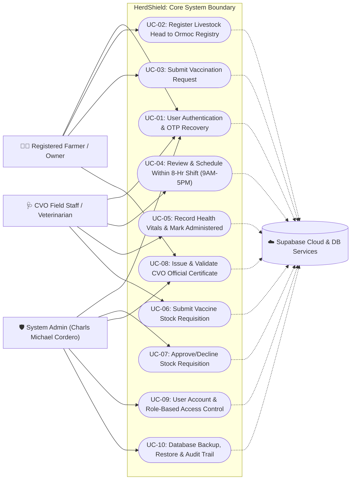
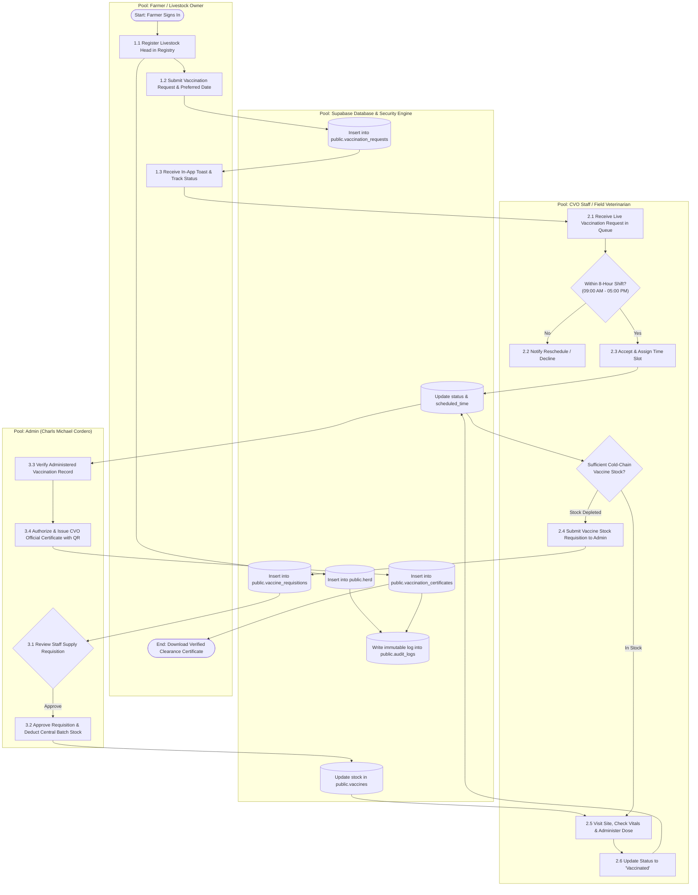
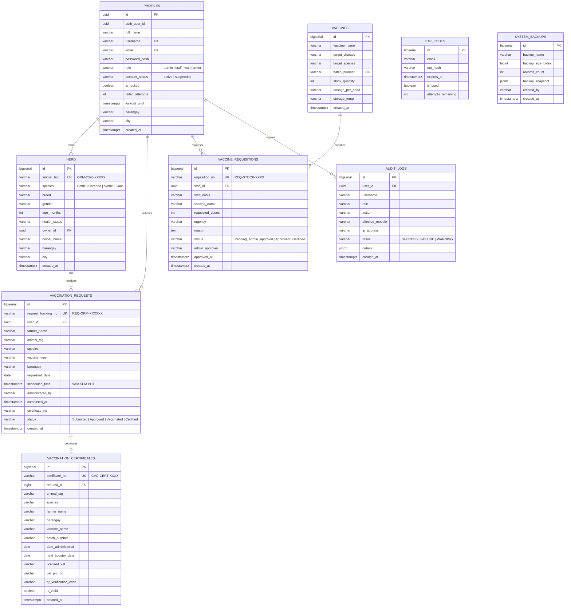
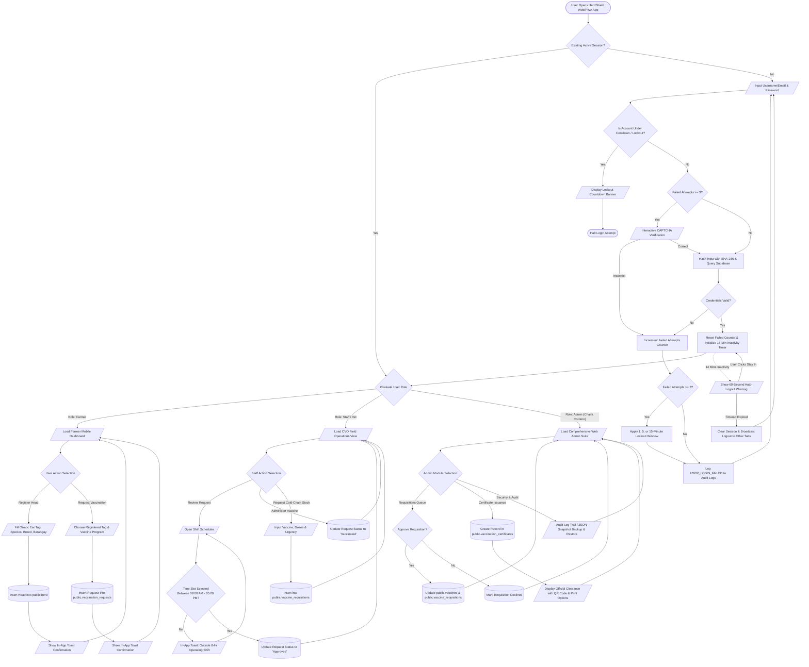
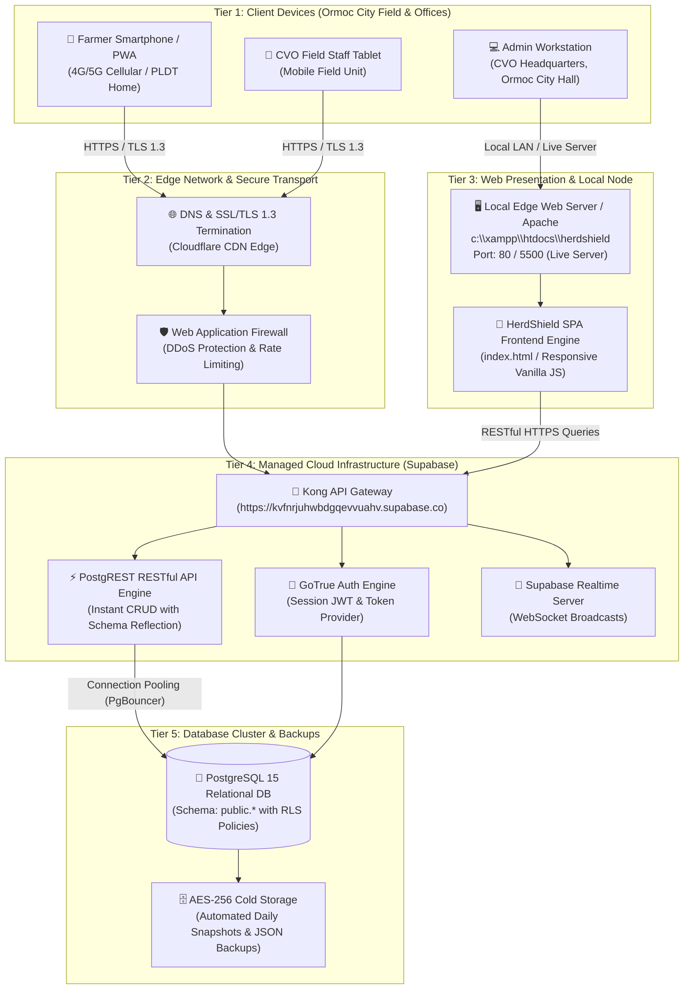

# SYSTEM INTEGRATION AND ARCHITECTURE (SIA)
## FINAL PROJECT SPECIFICATION & ARCHITECTURAL BLUEPRINT
### Implementation Checklist & Architectural Diagrams Documentation

---

- **System Title**: **HerdShield: Municipal Livestock Biosecurity, Vaccination Monitoring & Supply Requisition System**
- **Target LGU / Jurisdiction**: **City Government of Ormoc, Leyte (City Veterinary & Agriculture Office - CVO)**
- **Student / Project Proponent**: **Charls Michael Cordero** (Student No. 8)
- **Course & Evaluators**:
  - **System Integration and Architecture (SIA)**
  - **Application Development (AppDev)** – Mr. Ian Celmar A. Avila
  - **Information Assurance & Security 1 (IAS1)** – Mr. Roel Daniot

---

## 1. Use Case Diagram (System Users & Primary Roles)

### Actors Identified:
1. **Registered Farmer / Livestock Owner (Primary User)**:
   - Registers animal heads in the Ormoc City database.
   - Files field vaccination requests during municipal campaigns.
   - Monitors live vaccination status and downloads verified digital transit permits / certificates.
2. **Field Veterinarian / CVO Staff (Secondary Actor / Operator)**:
   - Evaluates incoming vaccination requests and schedules field appointments within the official 8-hour shift window (9:00 AM – 5:00 PM PHT).
   - Records physical livestock vitals and flags adverse biosecurity conditions.
   - Marks vaccination administration and submits cold-chain vaccine replenishment requisitions to Admin.
3. **City Veterinary Officer / System Administrator (Admin - Charls Michael Cordero)**:
   - Reviews, approves, or declines staff vaccine stock requisitions.
   - Issues and seals official CVO Vaccination & Transit Certificates with unique verification identifiers.
   - Manages user accounts, enforces RBAC, configures lockout rules, restores database snapshots, and reviews immutable IAS-1 audit logs.
4. **Supabase Cloud Backend & Auth Engine (Secondary Supporting System)**:
   - Authenticates credentials, validates SHA-256 password digests, executes RLS security rules, and persists ACID transactions.

---

## 2. System Flow Diagram (Cross-Functional Swimlanes & Pools)

This cross-functional swimlane diagram depicts a **Complete Transaction Cycle (3rd & 4th Increment Checking)**, illustrating interactions and handoffs between the **Farmer Pool**, **CVO Staff Pool**, **Admin Pool**, and the **Database Engine Pool**.

---

## 3. Entity-Relationship Diagram (ERD)

The database strictly conforms to **PostgreSQL / Supabase** relational integrity, utilizing Foreign Keys, Unique Indexes, and Row Level Security (RLS) constraints.

---

## 4. Comprehensive System Flowchart

The system flowchart maps the operational logic, security checks, and routing decisions from initial authentication to final certificate generation.

---

## 5. Network Diagram (Network Architecture & Distributed Data Flow)

The network model illustrates the distributed architecture connecting end-user devices in Ormoc City to edge services and the cloud database cluster.

---

## 6. Architecture & Implementation Compliance Matrix

| Requirement | SIA Standard Notation | HerdShield Implementation Reference | Status |
|---|---|---|:---:|
| **1. Use Case Diagram** | Standard UML Actors & Functionality Associations | 3 Primary Actors (Farmer, Staff, Admin) + 1 Supporting Service; 10 distinct Use Cases. | **COMPLIANT** |
| **2. Swimlane Flow** | Multi-Pool Cross-Functional BPMN Flow | 4 Discrete Swimlanes (Farmer, CVO Staff, Admin Charls Cordero, Database Engine) detailing complete handoffs. | **COMPLIANT** |
| **3. Database ERD** | Crow's Foot Relational Notation | 10 Entities (`profiles`, `herd`, `vaccines`, `vaccine_requisitions`, `vaccination_requests`, `vaccination_certificates`, `audit_logs`, `otp_codes`, `system_backups`, `ormoc_quarantine_advisories`). | **COMPLIANT** |
| **4. System Flowchart** | ANSI / ISO Flowchart Standard Symbols | Process boxes, diamonds for logic decisions, input/output trapezoids, and database cylinders covering authentication to certificate output. | **COMPLIANT** |
| **5. Network Diagram** | Multi-Tier Distributed Cloud Architecture | Detailed 5-Tier layout from Ormoc Client Devices to Cloudflare Edge, Local Apache/Live Server, Kong Gateway, and PostgreSQL DB. | **COMPLIANT** |
| **Unified Terms** | Consistent Nomenclature across all diagrams | System title: **HerdShield**; City: **Ormoc City**; Admin: **Charls Michael Cordero**; Shift: **9:00 AM - 5:00 PM PHT**. | **COMPLIANT** |

---
*Documentation compiled for System Integration and Architecture (SIA) Final Project Evaluation.*
